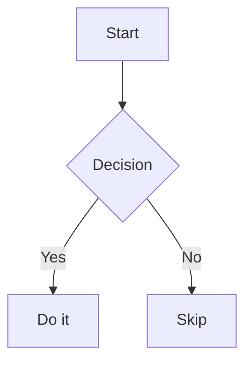

# Obsidian Flavored Markdown reference

Contents: Links, Embeds, Block IDs, Callouts, Formatting, Footnotes, Comments, Maths, Diagrams, Code, Tables, Lists and tasks, HTML, Portability.

## Links

```md
[[Note name]]
[[Note name|Display text]]
[[Folder/Note name]]            disambiguate duplicate names
[[Note name#Heading]]
[[Note name#Heading#Subheading]]
[[#Heading in this note]]
[[Note name#^block-id]]
[[#^block-id]]
```

- Wikilinks are the default for internal links. Obsidian updates them on rename.
- Standard Markdown links also work internally, with spaces encoded: `[Text](Three%20laws%20of%20motion.md)`.
- External links: `[Label](https://example.com)`.
- Block references and wikilinks are Obsidian-only and will show as plain text in other apps.

## Embeds

Prefix a link with `!` to embed instead of link.

```md
![[Note name]]
![[Note name#Heading]]
![[Note name#^block-id]]
![[image.png]]
![[image.png|400]]               width in pixels
![[image.png|400x300]]           width x height

![[audio.mp3]]
![[document.pdf]]
![[document.pdf#page=3]]
![[file.base]]                   embeds a Base
```

Embedded notes update when the source changes, so embed reusable definitions rather than copying them.

## Block IDs

Add at the end of a paragraph, quote or list item, preceded by a space:

```md
This paragraph can be linked to. ^key-point

- A list item ^list-item-id
```

For a block like a table, quote or list, put the ID on its own line after the block, with a blank line before and after:

```md
> A quote spanning
> several lines.

^quote-id
```

IDs use letters, digits and hyphens only.

## Callouts

```md
> [!note]
> Body text. Supports **Markdown**, [[wikilinks]] and ![[embeds]].

> [!tip] Custom title
> Body.

> [!tip] Title-only callout

> [!faq]- Collapsed by default
> Hidden until opened.

> [!info]+ Expanded but foldable
> Visible, can be collapsed.

> [!question] Outer
> > [!todo] Nested
> > > [!example] Nested again
```

Types: note, abstract/summary/tldr, info, todo, tip/hint/important, success/check/done, question/help/faq, warning/caution/attention, failure/fail/missing, danger/error, bug, example, quote/cite.

Custom types need a CSS snippet in the vault, so only use the built-in types unless the user has defined their own.

## Formatting

```md
**bold**  *italic*  ***both***  ~~strikethrough~~  ==highlight==  `inline code`
```

- Paragraphs are separated by a blank line. A single newline is not a line break in reading view; use two trailing spaces, a backslash, or `<br>` when a hard break is needed.
- Headings `#` to `######`. Use `##` as the top level inside a note when the filename is the title.
- Horizontal rule: `---` on its own line after a blank line (never as the first line, which starts frontmatter).

## Footnotes

```md
Sentence with a footnote.[^1] Another with a named one.[^note]

[^1]: The footnote text.
[^note]: Another footnote, can be multiple lines
    if the continuation is indented.

Inline footnote.^[This text appears as a footnote without a separate definition.]
```

## Comments

```md
Visible text %%hidden inline comment%% more visible text.

%%
Hidden block comment.
Spans multiple lines.
%%
```

Comments are hidden in reading view and are stripped by many exporters. Tag-like text inside `%%` is ignored by Obsidian.

## Maths (MathJax / LaTeX)

```md
Inline: $\frac{a}{b} = c$

Block:
$$
\int_0^\infty e^{-x^2}\,dx = \frac{\sqrt{\pi}}{2}
$$
```

- Use `$...$` and `$$...$$` only. Do not use `\(...\)` or `\[...\]`.
- Avoid a space directly inside the opening or closing single `$` of inline maths.
- A literal dollar amount needs escaping: `\$5`.

## Diagrams (Mermaid)

````md

````

Link a Mermaid node to a note with `class NodeName internal-link;`.

## Code

Use fenced blocks with a language: ` ```python `, ` ```bash `, ` ```json `, ` ```sql `. Use four backticks to wrap an example that itself contains a fence.

## Tables

```md
| Left | Centre | Right |
|:-----|:------:|------:|
| a    |   b    |     c |
| [[Note\|Alias]] | `a\|b` | x |
```

Escape pipes inside cells, including inside wikilinks and inline code.

## Lists and tasks

```md
- Bullet
  - Nested (indent with two or four spaces or a tab, stay consistent)

1. Numbered
2. Numbered

- [ ] Open task
- [x] Done task
- [ ] Task with a block ID ^task-id
```

Other task statuses (`[/]`, `[-]`, `[>]`) are theme- or plugin-dependent, so stick to `[ ]` and `[x]`.

## HTML

Obsidian does not render Markdown syntax inside HTML elements. `**bold**` inside a `<div>` stays literal. Safe uses: `<details><summary>Title</summary>` with plain text or HTML inside, `<kbd>Ctrl</kbd>`, `<br>`.

## Portability

If the note will leave Obsidian (GitHub, a static site, Pandoc):

- Prefer `[Text](path/File.md)` over `[[wikilinks]]`.
- Avoid block IDs, `%%comments%%`, `==highlights==`, callouts, and `![[embeds]]`.
- Keep frontmatter as YAML; most tools read it.
