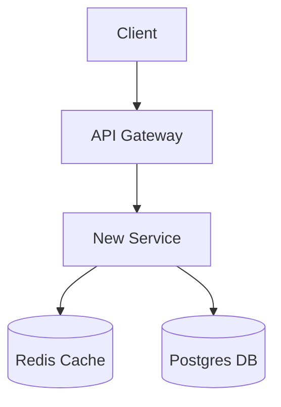

# RFC & Technical Spec

A skill for drafting production-grade Engineering RFCs and Technical Design Documents that align stakeholders, de-risk complex systems, and accelerate technical execution.

---

## Core Principles

1. **Problem & Scope First (Why Before How)**
   - Never dive straight into implementation details without establishing the customer or architectural pain point.
   - Strictly delineate **Goals** (what success looks like) from **Non-Goals** (what is explicitly out of scope). Defining non-goals is the primary defense against scope creep.

2. **Concrete Contracts & Architecture**
   - Provide concrete technical artifacts: typed interfaces (TypeScript, Go structs, Protobuf, or JSON schemas), database schemas, state machines, and sequence/architecture diagrams (using Mermaid).
   - Trace end-to-end data flows through the system components.

3. **Rigorous Trade-off Analysis**
   - Every architectural choice has costs. Document at least 1-2 viable alternatives and justify why the chosen path was selected (e.g. latency vs consistency, complexity vs time-to-market).
   - Explicitly note what compromises are being accepted.

4. **Production Readiness by Design**
   - Address operational realities upfront: backwards compatibility, database migrations, observability (logs, metrics, alerts), failure modes, rate limits, and rollback procedures.

5. **Style Defaults**
   - Australian/Commonwealth English spelling (e.g., *behaviour*, *synchronise*, *prioritise*).
   - Objective, precise technical writing without hand-waving or vague promises.
   - Clear Markdown formatting and no em dashes.

---

## Standard RFC Template

Produce comprehensive, production-ready specifications following this structure:

```markdown
# RFC: [Descriptive Feature or System Name]

**Author:** [Name]  
**Status:** [Draft / Under Review / Accepted / Superseded]  
**Target Release / Timeline:** [Quarter, Sprint, or Date]  
**Stakeholders / Reviewers:** [Engineers, Product, Security, Ops]

---

## 1. Summary & Context
### 1.1 Executive Summary
[A 2-3 sentence overview of what is being built, the core value proposition, and the high-level technical direction.]

### 1.2 Background & Problem Statement
[Describe the current state, pain points, technical debt, or new business requirements that necessitate this work. Include relevant metrics or failure examples if available.]

---

## 2. Goals & Non-Goals
### 2.1 Goals
- [Measurable outcome 1, e.g. "Reduce checkout latency from 800ms to <200ms p95."]
- [Feature capability 2.]

### 2.2 Non-Goals
- [Explicit out-of-scope item 1, e.g. "Supporting multi-region active-active replication in Phase 1."]
- [Out-of-scope capability 2.]

---

## 3. Proposed Architecture & System Design
### 3.1 High-Level Architecture
[Component interaction diagram (Mermaid) and narrative explanation of how components interact.]



### 3.2 Key Workflows & Sequences
[Step-by-step description or sequence diagram of the primary happy path and critical failure paths.]

---

## 4. Interfaces & Data Models
### 4.1 Data Models / Database Schema
```sql
-- Schema migration or entity definition
CREATE TABLE example_records (
    id UUID PRIMARY KEY DEFAULT gen_random_uuid(),
    created_at TIMESTAMPTZ NOT NULL DEFAULT NOW()
);
```

### 4.2 API Contracts
```typescript
// Interface or endpoint payload specification
interface CreateResourceRequest {
  readonly title: string;
  readonly metadata?: Record<string, string>;
}
```

---

## 5. Alternatives Considered & Trade-offs
| Approach | Pros | Cons | Verdict |
|---|---|---|---|
| **Option A (Proposed)** | [High throughput, simple operational footprint] | [Requires schema migration] | **Selected** |
| **Option B** | [Zero migration downtime] | [High memory overhead at scale] | Rejected |

---

## 6. Cross-Cutting Concerns
- **Security & Privacy:** Authentication, authorization, input validation, encryption at rest/in transit, PII handling.
- **Reliability & Failure Modes:** What happens when dependencies go down? Retries, circuit breakers, dead-letter queues.
- **Observability:** Key metrics (counters, histograms, latency p99), distributed trace propagation, error logs.
- **Backwards Compatibility:** Versioning strategy, API contract deprecation plan.

---

## 7. Rollout & Migration Plan
1. **Phase 1: Shadow / Dark Launch:** [Deploy without user-facing traffic; mirror requests to validate load and correctness.]
2. **Phase 2: Canary Deployment:** [Feature flag rollout to 1% -> 10% -> 100% of traffic.]
3. **Rollback Strategy:** [Exact operational steps or kill-switch feature flags to restore previous state in under 5 minutes.]

---

## 8. Open Questions
- [Unresolved question 1 requiring cross-team input or benchmarking.]
- [Unresolved question 2.]
```

---

## Workflow

1. **Extract Core Context**: If the user provides a brief idea, identify the main architectural boundaries and ask clarifying questions only if fundamental decisions (e.g., synchronous vs asynchronous, DB engine) are unknown.
2. **Draft the Document**: Fill out each section with practical, compilable, and context-specific details. Never output empty placeholder sections.
3. **Highlight Key Decisions**: End with a 2-sentence summary calling attention to the primary architectural trade-off and any critical open questions.
